# Delivery workflow graph (rendered)

Generated from `kit/.agents/workflow-graph.md` by `npm run render-graph`.
The YAML fence in that file is the source of truth; this file is a view.

```mermaid
flowchart TD
  reconcile["reconcile"]
  wait["wait"]
  judge["judge<br/><small>dod-auditor</small>"]
  planner["planner<br/><small>planner</small>"]
  plan_reviewer["plan_reviewer<br/><small>reviewer</small>"]
  ui_refiner["ui_refiner<br/><small>ui-refiner</small>"]
  refiner["refiner<br/><small>refiner</small>"]
  implementer["implementer<br/><small>implementer</small>"]
  parent_reviewer["parent_reviewer<br/><small>reviewer</small>"]
  walkthrough["walkthrough<br/><small>reviewer</small>"]
  handoff["handoff"]
  blocked["blocked"]
  step_pause["step_pause"]
  complete["complete"]
  reconcile -->|wait_live_session| wait
  reconcile -->|writer_handoff| handoff
  reconcile -->|recorded_blocker| blocked
  reconcile -->|step_pause| step_pause
  reconcile -->|stagnation_unknown| judge
  reconcile -->|stagnation| blocked
  reconcile -->|breakdown_unknown| judge
  reconcile -->|breakdown_invalid| planner
  reconcile -->|plan_unknown| judge
  reconcile -->|plan_findings_open| planner
  reconcile -->|plan_not_ready| plan_reviewer
  reconcile -->|planning_unknown| judge
  reconcile -->|child_in_progress| implementer
  reconcile -->|child_unfinished_unknown| judge
  reconcile -->|child_unfinished| implementer
  reconcile -->|child_blocked| blocked
  reconcile -->|ui_unknown| judge
  reconcile -->|ui_needed| ui_refiner
  reconcile -->|tech_unknown| judge
  reconcile -->|tech_needed| refiner
  reconcile -->|refinement_unresolved| judge
  reconcile -->|child_ready| implementer
  reconcile -->|descendants_unknown| judge
  reconcile -->|descendants_incomplete| judge
  reconcile -->|integration_unknown| judge
  reconcile -->|integration_incomplete| implementer
  reconcile -->|findings_unknown| judge
  reconcile -->|findings_owner_unknown| judge
  reconcile -->|fix_planner| planner
  reconcile -->|fix_implementer| implementer
  reconcile -->|parent_review| parent_reviewer
  reconcile -->|walkthrough_unknown| judge
  reconcile -->|walkthrough_needed| walkthrough
  reconcile -->|closeout_unknown| judge
  reconcile -->|closeout_incomplete| implementer
  reconcile -->|complete| complete
  reconcile -->|unmatched| judge
```

## Edge table

| Edge | Target |
| --- | --- |
| wait_live_session | wait |
| writer_handoff | handoff |
| recorded_blocker | blocked |
| step_pause | step_pause |
| stagnation_unknown | judge |
| stagnation | blocked |
| breakdown_unknown | judge |
| breakdown_invalid | planner |
| plan_unknown | judge |
| plan_findings_open | planner |
| plan_not_ready | plan_reviewer |
| planning_unknown | judge |
| child_in_progress | implementer |
| child_unfinished_unknown | judge |
| child_unfinished | implementer |
| child_blocked | blocked |
| ui_unknown | judge |
| ui_needed | ui_refiner |
| tech_unknown | judge |
| tech_needed | refiner |
| refinement_unresolved | judge |
| child_ready | implementer |
| descendants_unknown | judge |
| descendants_incomplete | judge |
| integration_unknown | judge |
| integration_incomplete | implementer |
| findings_unknown | judge |
| findings_owner_unknown | judge |
| fix_planner | planner |
| fix_implementer | implementer |
| parent_review | parent_reviewer |
| walkthrough_unknown | judge |
| walkthrough_needed | walkthrough |
| closeout_unknown | judge |
| closeout_incomplete | implementer |
| complete | complete |
| unmatched | judge |
